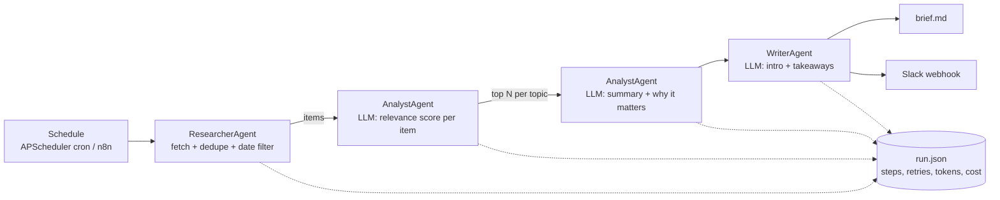

# agent-ops

A scheduled multi-agent research pipeline. It reads RSS/Atom feeds, an **analyst** agent scores and summarises what's relevant to your topics, and a **writer** agent produces a weekly Markdown brief. It can post the brief to Slack. Every run is recorded with per-step timing, retries, token usage and estimated cost.

It runs on its own schedule (APScheduler, cron syntax) or as a step in an **n8n** workflow.




## Why it's built this way

- **Agents with narrow jobs.** The researcher makes no LLM calls. The analyst only summarises items that pass the relevance threshold, so tokens aren't spent on irrelevant news. The writer runs once per brief.
- **Failure isolation.** Each feed is retried with exponential backoff, independently. One broken feed is logged in the run record and doesn't fail the run. If every feed fails, the run is marked `failed` with a clear error.
- **Observability.** `runs/<run_id>/run.json` holds each step's status, duration, attempts and details, plus LLM calls, input/output tokens and estimated cost per task.
- **Typed LLM outputs.** Relevance, summaries and the brief are all Pydantic schemas, returned with `messages.parse` on the Anthropic provider.

## Quick start

```bash
python -m venv .venv && source .venv/bin/activate    # Windows: .venv\Scripts\activate
pip install -e ".[dev]"

agent-ops run --print         # one run against the bundled sample feeds, prints the brief
agent-ops runs                # history: status, items, tokens, cost
agent-ops show <run_id>       # step table + brief for one run
agent-ops schedule            # blocking scheduler using the cron in config/pipeline.toml
pytest                        # 10 tests
```

Sample output (mock provider):

```text
                 Run 20261104-183500-b961aa - ok
| Step     | Status | ms    | Attempts | Detail                                        |
| research | ok     | 96.79 | 1        | feeds 3, fetched 14, after dedupe 14          |
| analyse  | ok     | 4.18  | 1        | scored 14, kept 8, dropped 6                  |
| write    | ok     | 1.01  | 1        | 4684 chars, 3 takeaways                       |
| deliver  | ok     | 0.03  | 1        | slack: false                                  |
LLM (mock): 23 calls, 4212 in / 1237 out tokens, est. cost $0.0416 at claude-opus-5-5 pricing
```

## Configuration

Everything is in [`config/pipeline.toml`](config/pipeline.toml): topics and keywords, feeds (URLs or local files), cron schedule, items per topic, relevance threshold, lookback window and output settings. Set `SLACK_WEBHOOK_URL` to post the brief to Slack.

## LLM providers

- **`mock`** (default): keyword relevance scoring, extractive summaries and a templated brief. It needs no API key. Token counts are *estimated* (about 4 characters per token), so cost tracking can still be tested.
- **`anthropic`**: Claude (`claude-opus-5-5` by default). Token counts come from the API's `usage` field.

```bash
LLM_PROVIDER=anthropic ANTHROPIC_API_KEY=sk-ant-... agent-ops run --print
```

## Running from n8n

Import [`n8n/weekly-brief.workflow.json`](n8n/weekly-brief.workflow.json). The workflow does the following:

1. A Schedule Trigger fires every Monday at 08:00.
2. An Execute Command node runs `agent-ops run --json`.
3. A Code node parses the run record.
4. An IF node checks the result. On success, n8n reads `brief.md` and posts a summary to Slack. On failure, it alerts `#automation-alerts`.

The Execute Command node needs n8n self-hosted with `agent-ops` installed in the same container or on the same host.

## Project layout

```
src/agent_ops/
  config.py      TOML config -> Pydantic
  agents.py      ResearcherAgent, AnalystAgent, WriterAgent
  pipeline.py    orchestrator + error handling
  telemetry.py   RunRecorder, step context manager, retry with backoff, run history
  llm.py         provider interface + UsageMeter (tokens, cost)
  mock_rules.py  deterministic agent behaviour for mock mode
  cli.py         run | runs | show | schedule
config/pipeline.toml
data/feeds/      fictional sample RSS feeds for offline runs
n8n/             importable workflow
```

## License

MIT
